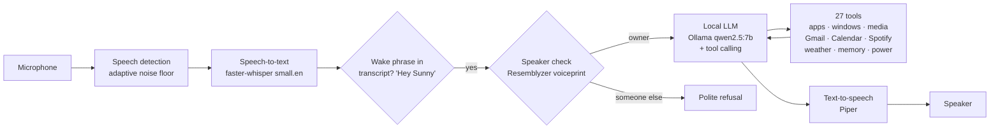

# Sunny: a private, fully local voice assistant for Linux

**Python · faster-whisper · Ollama (local LLM with tool calling) · Piper TTS · Resemblyzer speaker verification · systemd**

Say *"Hey Sunny"* and ask: open apps, control windows and browser tabs, play music on Spotify or YouTube, read
your unread email, check or add calendar events, get the weather or a morning briefing, change volume, lock the
screen. **Everything runs on the laptop**: speech recognition, the language model and the voice. No cloud
assistant, no subscription, no audio leaves the machine.

## How it works



- **Wake word without a separate model**: the wake phrase (and common mishearings) is matched in the Whisper
  transcript, so there is no extra wake-word engine to train.
- **Speaker verification**: it only takes orders from the enrolled voice (`enroll_voice.py` stores a voiceprint);
  the threshold is configurable.
- **Tool calling**: the LLM decides which of 27 Python functions to call (`skills.py`), e.g. `open_app`,
  `window_control`, `browser_tab`, `spotify_play`, `open_email`, `get_weather`, `morning_briefing`, `remember`.
- **Safety in the loop**: actions with side effects (sending email, adding events, installing software, shell
  commands) are confirmed out loud first; shell commands that could wipe the system or need `sudo` are refused,
  and installs open a visible terminal where the user types the password.
- **Memory**: facts the user asks it to remember persist across sessions.
- **Runs as a background service** (systemd user unit), restarts itself if it crashes; a battery mode keeps speech
  recognition on the CPU so the GPU can sleep.
- Developed on a laptop with an RTX 3050 (6 GB): qwen2.5:7b mostly fits in VRAM; qwen2.5:3b for slower machines.

## Setup (Ubuntu 24.04)

```bash
git clone https://github.com/General106/sunny ~/sunny && cd ~/sunny
python3 -m venv .venv && .venv/bin/pip install -r requirements.txt

# local LLM
curl -fsSL https://ollama.com/install.sh | sh
ollama pull qwen2.5:7b

# Piper voice (put both files in data/)
#   en_US-ryan-medium.onnx + en_US-ryan-medium.onnx.json from https://huggingface.co/rhasspy/piper-voices

# your name and preferences
nano config.py              # USER_NAME, ASSISTANT_NAME, LLM_MODEL, BRIEFING_TIME, ...

.venv/bin/python enroll_voice.py   # teach it your voice (once)
./run.sh                           # say "Hey Sunny ..."
./run.sh --text                    # keyboard test mode
```

Run in the background:

```bash
mkdir -p ~/.config/systemd/user && cp systemd/sunny.service ~/.config/systemd/user/
systemctl --user daemon-reload && systemctl --user enable --now sunny
journalctl --user -u sunny -f      # live log
```

### Optional: Gmail + Google Calendar

1. In https://console.cloud.google.com create a project, enable the **Gmail API** and **Google Calendar API**.
2. OAuth consent screen → External → add yourself as a test user.
3. Credentials → OAuth client ID → **Desktop app** → download the JSON to `data/google_credentials.json`.
4. `.venv/bin/python connect_google.py` and approve in the browser (token saved in `data/`).

### Optional: Spotify

1. Create an app at https://developer.spotify.com/dashboard with redirect URI `http://127.0.0.1:8888/callback`.
2. Put `{"client_id": "...", "client_secret": "..."}` in `data/spotify.json`.
3. `.venv/bin/python connect_spotify.py` and approve in the browser.

All credentials, tokens, the voiceprint and memory live in `data/`, which is git-ignored.

## Files

| file | role |
|---|---|
| `jarvis.py` | main loop: listen → wake word → speaker check → LLM with tools → speak |
| `audio.py` | microphone capture, VAD, Whisper transcription, voice matching, Piper speech |
| `skills.py` | the tools the LLM can call |
| `google_skills.py`, `spotify_auth.py` | Gmail/Calendar and Spotify integrations |
| `config.py` | all settings |
| `power.py` | battery / performance handling |
| `enroll_voice.py`, `connect_google.py`, `connect_spotify.py` | one-time setup scripts |

## License

MIT, see [LICENSE](LICENSE).
